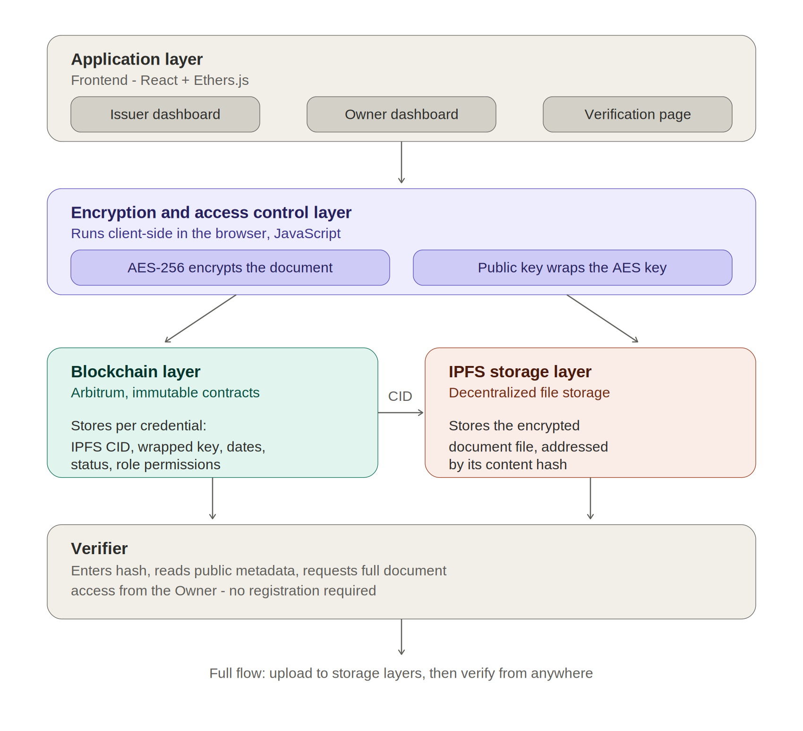
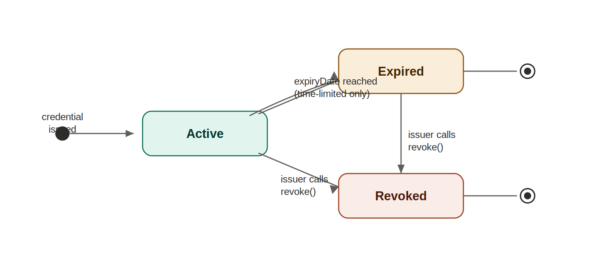
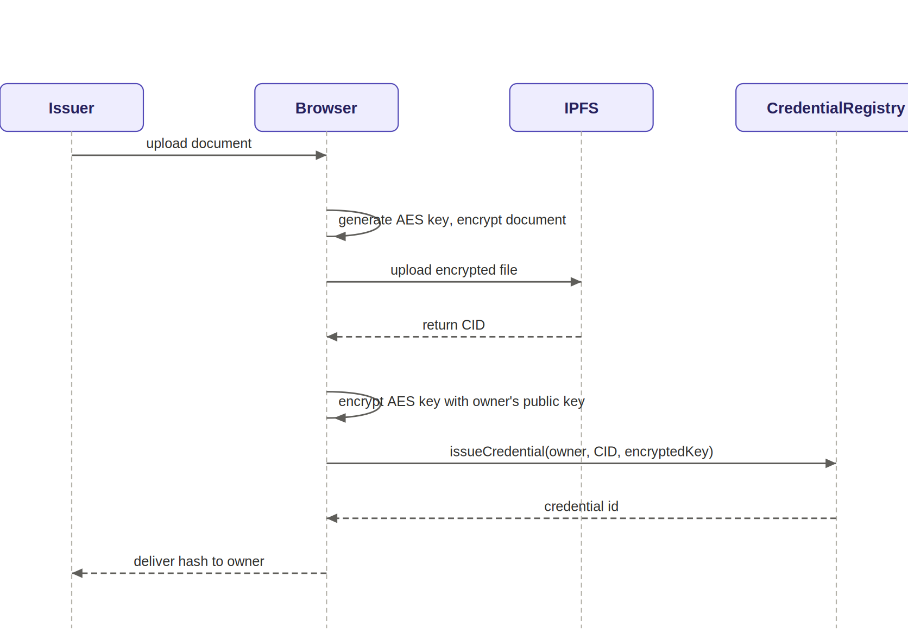
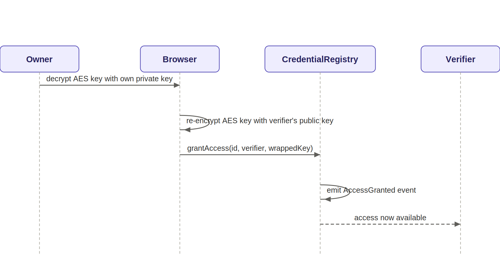
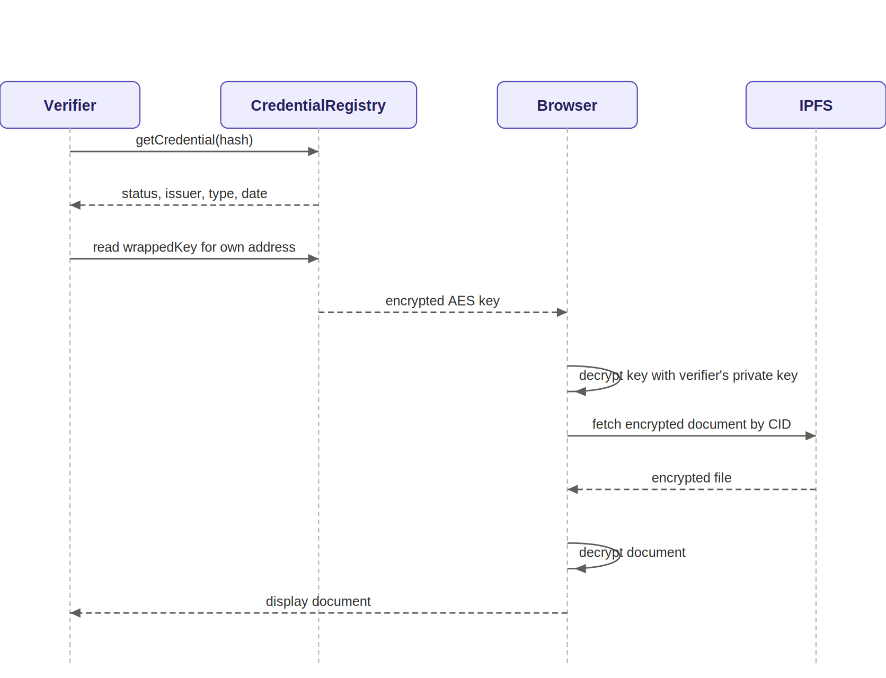

<div align="center">

# Attestera

**Verify an academic credential in seconds, without a middleman and without exposing the document.**

Issue, revoke and verify credentials on-chain. The document itself stays encrypted, and only the holder decides who may read it.

[](contracts/src)
[](contracts/test)
[](https://sepolia.arbiscan.io)
[](frontend)

[**Live demo**](https://attestera-nu.vercel.app) · [Architecture](#architecture) · [How the encryption works](#how-the-encryption-works) · [Quick start](#quick-start) · [Documentation](#documentation)

</div>

---

## Why this exists

Checking a degree today usually means emailing a registrar, waiting, and trusting that one institution's database is both correct and still online. Forged certificates are hard to spot, and publishing the real ones is not an option because they contain personal data.

Attestera splits the problem in two:

| What | Where it lives | Who can see it |
|---|---|---|
| **Proof** that a credential exists, who issued it, and whether it is active, expired or revoked | Two immutable smart contracts on Arbitrum | Anyone, no wallet needed |
| **The document itself** (PDF, image, ...) | IPFS, encrypted in the browser before upload | Only the holder, and anyone the holder grants access to |

There is no backend server. All cryptography runs in the user's browser.

## Highlights

- **Public verification.** Look up a credential ID and read its status straight from the chain. No account, no wallet.
- **Private documents.** AES-256-GCM encryption happens client-side. IPFS only ever stores ciphertext.
- **Per-recipient access.** The holder grants or revokes access to each verifier. Granting costs one small transaction, and the file on IPFS is never re-encrypted.
- **No new keys to look after.** The encryption key pair is derived from a deterministic wallet signature, so users never store an extra private key.
- **Permissioned issuance.** Only institutions approved by the admin can issue. Only the issuer of a credential can revoke it, and revocation is permanent.
- **Expiry without extra transactions.** "Expired" is computed from the block time at read time.
- **Thoroughly tested.** 64 tests, including fuzz and invariant tests.

## Architecture

<p align="center">
  
</p>

### Smart contracts

| Contract | Responsibility |
|---|---|
| [`AccessControlRegistry`](contracts/src/AccessControlRegistry.sol) | Admin (immutable), approved institutions, the list of majors, and each user's 64-byte encryption public key |
| [`CredentialRegistry`](contracts/src/CredentialRegistry.sol) | Credentials (ID, owner, issuer, IPFS CID, type, major, dates), their status, and the wrapped keys that grant access |

`CredentialRegistry` talks to `AccessControlRegistry` through a two-function interface (`isApprovedIssuer`, `isValidMajor`), so it can be tested against a 35-line mock. Both contracts are immutable: no proxies, no upgrade path.

A credential's ID is `keccak256(owner, issuer, cid, timestamp, nonce)`.

### Roles

| Role | Can do |
|---|---|
| **Admin** | Approve or revoke institutions, add majors |
| **Issuer** (approved institution) | Issue credentials to a holder's address, revoke credentials it issued |
| **Owner** (holder) | See own credentials, grant or revoke a verifier's access, decrypt own document |
| **Verifier** | Check any credential's status without a wallet. Decrypt the document if the holder granted access |

### Credential lifecycle

<p align="center">
  
</p>

## How the encryption works

Attestera uses hybrid encryption, so a large file is encrypted once and sharing it only means sharing a tiny key.

1. **Key pair from the wallet.** The user signs a fixed message once. The SHA-256 hash of that deterministic signature becomes a secp256k1 private key. The matching 64-byte public key is registered on-chain.
2. **Encrypt the document.** At issuance the browser creates a random AES-256 key and encrypts the file with AES-GCM, with a fresh 12-byte IV. The original file name is packed inside the encrypted part, so IPFS metadata reveals nothing. The ciphertext is uploaded to IPFS and returns a CID.
3. **Wrap the key for each recipient.** The AES key is wrapped with ECIES (ephemeral key, ECDH, HKDF, AES-GCM). The result is **124 bytes**: 64-byte ephemeral public key, 12-byte IV and 48-byte ciphertext. It is stored on-chain in `accessGrants[id][recipient]`.
4. **Share by re-wrapping.** To grant access, the holder unwraps the AES key with their own private key and wraps it again for the verifier's public key. One `grantAccess` transaction, and the file on IPFS is untouched.

<details>
<summary><b>Sequence diagrams</b> (issue, grant access, verify)</summary>
<br>

**Issuing a credential**



**Granting access to a verifier**



**Verifying a credential**



</details>

## Deployed contracts

Arbitrum Sepolia (chain ID `421614`):

| Contract | Address |
|---|---|
| `AccessControlRegistry` | [`0xf91a608c8584bBA45D771F29b3ABBe78796bEF60`](https://sepolia.arbiscan.io/address/0xf91a608c8584bBA45D771F29b3ABBe78796bEF60) |
| `CredentialRegistry` | [`0xDb02DC28122b841F02EF82ff624CA6afB0334CfB`](https://sepolia.arbiscan.io/address/0xDb02DC28122b841F02EF82ff624CA6afB0334CfB) |

## Quick start

**Requirements:** [Foundry](https://book.getfoundry.sh), Node.js 20+, an EVM wallet extension such as MetaMask set to Arbitrum Sepolia, and a free [Pinata](https://app.pinata.cloud) account for IPFS.

### 1. Contracts

```bash
cd contracts
curl -L https://foundry.paradigm.xyz | bash && foundryup
mkdir -p lib && git clone https://github.com/foundry-rs/forge-std lib/forge-std
forge test
```

To deploy to Arbitrum Sepolia, create `contracts/.env` (never commit it):

```bash
PRIVATE_KEY=...                  # a throwaway testnet wallet
ARBITRUM_SEPOLIA_RPC_URL=https://sepolia-rollup.arbitrum.io/rpc
ARBISCAN_API_KEY=                # optional, only for --verify
```

```bash
forge script script/Deploy.s.sol --rpc-url arbitrum_sepolia --broadcast
```

The script prints both addresses. The deploying wallet becomes the admin.

### 2. Frontend

```bash
cd frontend
npm install
cp .env.example .env
npm run dev
```

Set these in `frontend/.env`:

```bash
VITE_ACCESS_CONTROL_REGISTRY_ADDRESS=0x...
VITE_CREDENTIAL_REGISTRY_ADDRESS=0x...
VITE_PINATA_JWT=...              # Pinata -> API Keys -> New Key (enable pinFileToIPFS)
```

### 3. Try all four roles

Use a separate wallet account for each role. Issuer, owner and verifier accounts need a little Arbitrum Sepolia ETH and must complete the one-time "enable encryption" signature before sending or receiving an encrypted key.

1. **Admin** (the deployer wallet) approves an institution and adds a major.
2. **Issuer** uploads a document and issues a credential to the owner's address.
3. **Owner** sees the credential, enters a verifier's address and grants access.
4. **Verifier** enters the credential ID, sees its status and decrypts the document.
5. **Owner** revokes the verifier's access, or the **issuer** revokes the credential.

## Testing

```bash
cd contracts
forge test            # all 64 tests
forge test -vvv       # with traces
```

| Suite | Tests | What it checks |
|---|---:|---|
| `AccessControlRegistry.t.sol` | 24 | Admin permissions, institutions, majors, key registration |
| `CredentialRegistry.t.sol` | 26 | Issuing, revoking, access grants, status, expiry |
| `CredentialRegistry.fuzz.t.sol` | 6 | Random inputs (256 runs each), such as the exact expiry boundary |
| `CredentialRegistry.invariant.t.sol` | 4 | Properties that must always hold, with a handler and ghost state |
| `Integration.t.sol` | 4 | Full flows across both contracts |

The invariants (`runs = 64`, `depth = 50`, `fail_on_revert = true`):

- A revoked credential never becomes active again.
- Every issued credential stays readable.
- Every credential ID appears in its owner's list.
- No two credentials share an ID.

## Security notes

This is a proof of concept on a test network. It has not had a professional audit. Known limitations:

- **Revoking access cannot undo a past download.** A verifier who already decrypted a document may have kept a copy.
- **Pinata token in the browser bundle.** Vite inlines `VITE_PINATA_JWT` at build time, so it is extractable. Production use needs a small proxy server that holds the token.
- **Fixed admin.** The admin is set at deployment and trusted to approve institutions. There is no multisig and the contracts are not upgradeable.
- **Key derivation relies on a deterministic signature and a fixed message.** A typed EIP-712 message would better resist phishing, and there is no key recovery.
- **Credential metadata is public.** Only the document content is encrypted.

## Roadmap

- Pinata proxy server
- Multisig admin
- Automatic issuance from university systems
- Student identity verification
- Mobile interface
- EIP-712 activation message and a professional audit
- Contract-wallet support (ERC-1271) and W3C Verifiable Credentials export

## Documentation

| | |
|---|---|
| **Project report** | [English](Attestera_EN_Docs.docx) · [فارسی](Attestera_Farsi_Docs.docx) |
| **Presentation** | [AttesteraPresentation.pptx](AttesteraPresentation.pptx) |
| **Proposal** | [English](docs/Credential_Registry_Proposal_EN.docx) · [فارسی](docs/Credential_Registry_Proposal_FA.docx) |
| **Design decisions** | [Design Decisions Log](docs/Design_Decisions_Log.docx) |
| **Implementation** | [Implementation Plan](docs/Implementation_Plan.docx) · [Backend Code Walkthrough](docs/Backend_Code_Walkthrough.docx) |
| **Cryptography** | [Encryption Module Deep Dive](docs/Encryption_Module_Deep_Dive.docx) |
| **Diagrams** | [docs/diagrams](docs/diagrams) (architecture, class, use case, sequence, state, deployment) |

If you are reading the code for the first time, start with the proposal, then the design decisions log, then `contracts/src/` and `frontend/src/lib/encryption.js`.

## Project structure

```
Attestera/
├── contracts/              Foundry project
│   ├── src/                AccessControlRegistry.sol, CredentialRegistry.sol
│   ├── test/               unit, fuzz, invariant and integration tests
│   └── script/Deploy.s.sol
├── frontend/               React + Vite + Tailwind + ethers v6
│   └── src/
│       ├── lib/            wallet, contracts, encryption, storage (Pinata/IPFS)
│       ├── components/
│       └── pages/          Admin, Issuer, Owner, Verifier dashboards
└── docs/                   Proposal, design log, walkthroughs, diagrams
```

## Author

Built by [Elmira Taghinasab](https://github.com/Elmirataghinasab) as a bachelor's project in Computer Engineering at Tabriz University of Technology.
